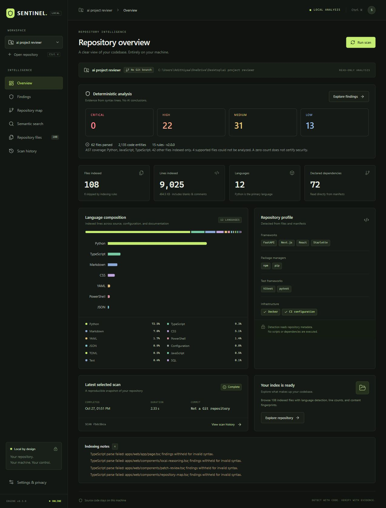
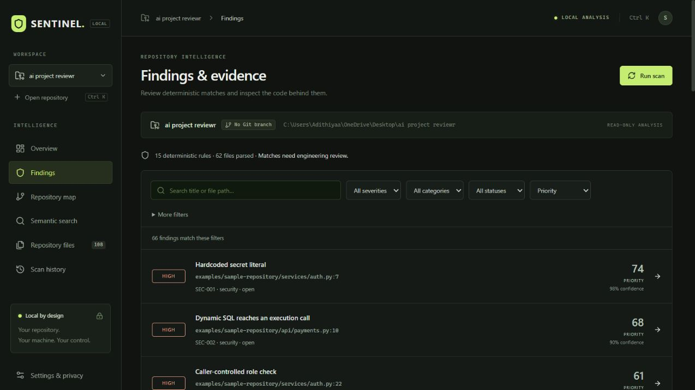
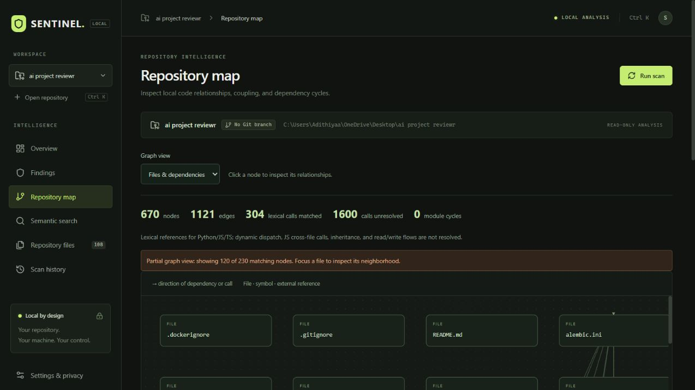
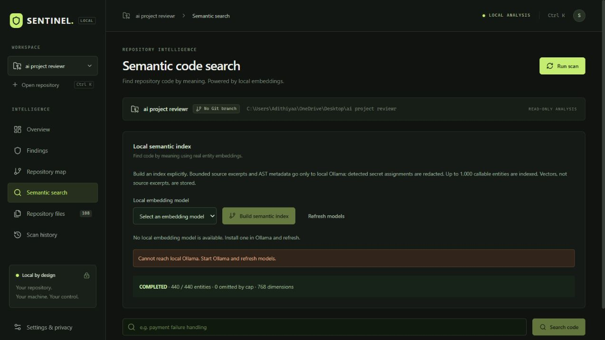
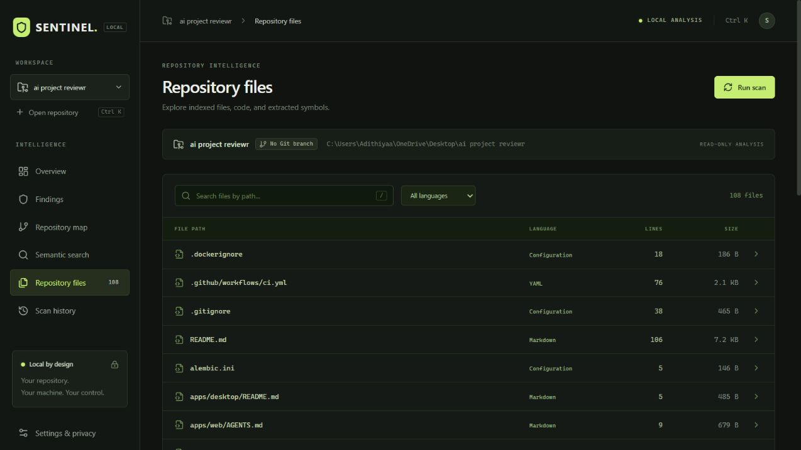
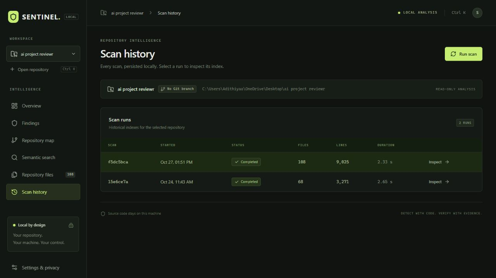

# Output gallery

These screens were captured from the running local production application against the SENTINEL repository. Values depend on the selected repository and scan.

## Repository overview

Overview combines scan identity, analysis coverage, severity totals, indexed files and lines, language composition, frameworks, package managers, test tools, and the most recent selected scan.

## Findings and evidence

Findings are deterministic rule matches. The interface exposes severity, category, review status, priority, confidence, file, line, and rule identifier. Matches require engineering review.

## Repository map

The graph presents resolved files, entities, imports, dependencies, and lexical calls. It also reports unresolved calls and detected file cycles so limitations remain visible.

## Semantic search

Semantic search is optional and local. It becomes available when Ollama is reachable and an embedding model is installed. Building the index is an explicit operation.

## Repository files

The file browser searches indexed paths and filters by language. Inspecting source requires the current file hash to match the fingerprint stored for the selected scan.

## Scan history

Scan history preserves completed and failed runs with timestamps, file counts, line counts, duration, and a stable scan identifier.

## Machine-readable outputs

FastAPI exposes JSON for repository registration, scans, files, findings, review status, graphs, semantic indexes, searches, reasoning jobs, patch proposals, validations, applies, and rollbacks. See the [API reference](api.md).

## Academic output

The project includes a one-page Times New Roman abstract at [SENTINEL Project Abstract](../output/pdf/SENTINEL_Project_Abstract.pdf) and a [detailed project report](SENTINEL_DETAILED_REPORT.md).
