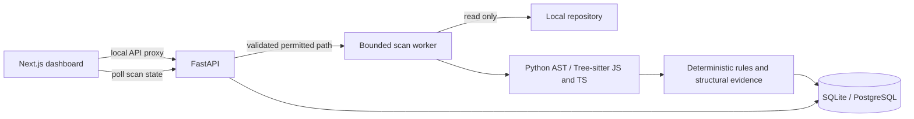

# Architecture

Phases 1–4 provide an executable path from local files through indexing, AST parsing, deterministic rules, persisted findings, an evidence viewer, and optional local model opinions. See [analysis coverage](analysis.md).

## Boundaries

- **Web:** renders server state, registers repositories, starts scans, and polls progress. It never reads the host filesystem directly. It does not invent security or health scores for an indexed repository.
- **API:** validates input, constrains browsing and repository registration to allowed roots, persists repositories and scans, and schedules indexing work without blocking request handlers.
- **Indexer:** discovers supported text files, applies excludes, detects languages, counts lines and bytes, hashes content, and detects project tooling and dependency declarations. It does not import or execute code from the repository.
- **Database:** SQLAlchemy models and Alembic migrations provide the same application contract for local SQLite and PostgreSQL. Scans own immutable indexed file snapshots; the repository record identifies the selected filesystem location.
- **Worker:** a bounded in-process executor is the local job mechanism. This is a single-process local application, not a distributed Celery deployment. Do not start multiple API worker processes against this queue.

## Scan lifecycle

A scan transitions through `queued`, `running`, and either `completed` or `failed`. Progress and stage fields make intermediate state visible to the dashboard. Completed scans retain measured statistics and indexed file rows, allowing users to inspect prior results. Failures remain visible rather than being represented as empty successful scans.

Indexing is a read-only operation. It does not install dependencies, run package manager scripts, execute application code, or call a model. Dependency versions describe manifest declarations, not an online vulnerability audit or proof of the installed dependency tree.

Discovery is bounded to 50,000 visited files and 10,000 directories, with 2 MiB per text file and 256 MiB of indexed text per scan. Supported text is decoded as UTF-8; other encodings and binary content are skipped. Warnings identify incomplete scans and excluded unreadable/oversized files. A completed scan can therefore represent a bounded subset, and its warnings must be reviewed before interpreting its totals. Line counts are physical lines, including comments and blanks. The index is a read-only observation of files during discovery, not an atomic Git snapshot.

## Analysis pipeline

The worker re-reads files against their indexed hashes, extracts CodeEntity records, evaluates versioned rules, and atomically persists findings and evidence. Lexical callees and bounded resolved graph relationships are stored; dynamic dispatch remains unresolved. A separate single-flight reasoning worker persists validated Ollama opinions without changing findings. Findings are immutable except for manual review status and its timestamp. Deterministic rules establish evidence before any model explanation. The provider uses local Ollama with strict structured output validation and explicit uncertainty; see [local AI](local-ai.md).

Patch application and tests are separate future trust boundaries. They must require a reviewed diff, explicit approval, sandboxed validation, and rollback on failure. No current interface claims those operations are available.

## Graph and retrieval pipeline

New scans persist bounded lexical graphs alongside entities and findings. A separate single-flight embedding worker reads hash-verified excerpts, calls local Ollama, and persists normalized vectors. Search uses exact cosine similarity over up to 1,000 entities. See [graph and search design](graph-search.md).

## Reviewed-change worker

A separate single-flight worker generates validated Python diff proposals and stages indexed Python files for Docker-only pytest validation. Proposals retain original/replacement source for rollback. Apply persists intent before an atomic single-file replacement; startup reconciles interrupted mutations against hashes. See [reviewed-change scope](reviewed-changes.md).
